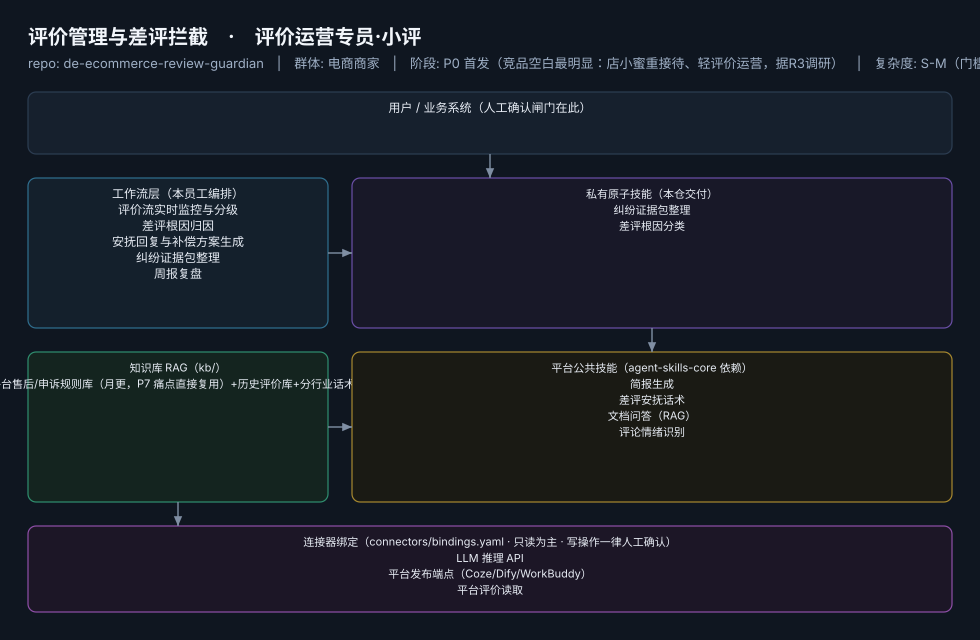

# 评价管理与差评拦截

> 评价运营专员·小评 ｜ 把评价从售后成本变成可监控、可归因、可修复的运营资产
>
> **评价运营专员·小评**　·　电商商家　·　阶段 P0 首发（竞品空白最明显：店小蜜重接待、轻评价运营，据R3调研）　·　
> 复杂度 S-M（门槛全图谱最低之一）　·　50-100 元/月（"评分是命根子"）　·　定义卡 6.4-③



**一句话**：退货率高、评分敏感类目（服饰/美妆/食品）一人店

---

## 这个数字员工解决什么问题

**闲鱼适配**："差评预警+归因诊断"是低门槛高感知钩子，可做 ¥19.9 单次诊断报告 SKU 引流至订阅。

| 项 | 内容 |
|---|---|
| 服务对象 | 退货率高、评分敏感类目（服饰/美妆/食品）一人店 |
| 可量化目标 | 差评响应 ≤2 小时；中差评挽回率 ≥30%；DSR 环比不降 |
| 投入产出 | 一条差评挽回≈保住链接日销（按日利 ¥100 计一次回本）+ 月省 10h≈¥300 |
| 需求依据 | D08（边缘） |
| 分发渠道 | GitHub、闲鱼（差评诊断报告钩子 SKU）、小红书 |

## 30 秒上手

```bash
git clone <本仓库地址> && cd de-ecommerce-review-guardian
pip install pyyaml
python3 tests/run.py            # 先跑一遍自检，确认环境与契约都对得上
```

试用（把 `<输入>` 换成本人真实材料）：

```text
请以「评价管理与差评拦截」的身份，帮我跑「评价流实时监控与分级」。
材料如下：<输入>
要求：只使用材料里出现过的数字，缺的写 <待填>；对外文案停在待确认状态。
```

详细接入见 [`docs/01-安装与接入.md`](docs/01-安装与接入.md)。

## 仓库结构

```text
de-ecommerce-review-guardian/
├── employee.yaml          # 机器契约（能力清单 + 依赖锁）
├── dependencies.yaml      # 对 core 的外部依赖（含版本）
├── persona/               # 运行提示词 / 边界 / KPI
├── skills/                # 私有原子技能（2 个）
├── spec-bindings/         # 有意不公共化能力的本地绑定声明（0 个）
├── workflows/             # 本员工工作流（5 条）
├── kb/                    # 知识库 RAG 契约
├── connectors/            # 连接器绑定（只读为主，写操作人工确认）
├── docs/                  # 六类发布文档
└── tests/                 # 自动化多场景测试
```

## 私有原子技能（2）

| 技能 | slug | 复杂度 | 阶段 | 成熟度 |
|---|---|---|---|---|
| `纠纷证据包整理` | `dispute-evidence-pack` | S | P1 | 契约完备 |
| `差评根因分类` | `negative-review-rootcause` | S | P0 | 契约完备 |

## 平台公共技能依赖（4）

| 技能 | slug | 全平台复用员工数 |
|---|---|---|
| `简报生成` | `brief-generator` | 10 |
| `差评安抚话术` | `complaint-soothe` | 3 |
| `文档问答（RAG）` | `doc-qa-rag` | 3 |
| `评论情绪识别` | `review-sentiment-tag` | 5 |

> 这些技能来自 `agent-skills-core@1.0.0`，本仓库**只引用不复制**。

## Spec 绑定层（0）

（无）

> 这一族能力**有意不公共化**（与外部平台接口强绑定）。本仓不存正文，
> 只留本地绑定声明与连接器配置。

## 工作流（5）

| 工作流 | slug | 触发 | 阶段 | 调用技能数 |
|---|---|---|---|---|
| `评价流实时监控与分级` | `wf-ecom-review-monitor` | 定时（每 30 分钟） | P0 | 1 |
| `差评根因归因` | `wf-ecom-review-root-cause` | 事件（新差评） | P0 | 1 |
| `安抚回复与补偿方案生成` | `wf-ecom-review-soothe` | 人工确认 | P0 | 1 |
| `纠纷证据包整理` | `wf-ecom-review-evidence` | 人工 | P1 | 1 |
| `周报复盘` | `wf-ecom-review-weekly` | 定时（周一） | P0 | 1 |

## 知识库与连接器

- 知识库语料：['平台售后/申诉规则库（月更，P7 痛点直接复用）+历史评价库+分行业话术库']
- 连接器：LLM 推理 API、平台发布端点（Coze/Dify/WorkBuddy）、平台评价读取

## 质量与验收

| 项 | 值 |
|---|---|
| 技能文件数 | 112 |
| 多场景用例数 | 202 |
| 用例通过 | 202 |
| 验收结论 | ✅ 通过 |

完整报告：[`docs/05-验收与测试.md`](docs/05-验收与测试.md)

## 许可

专有许可，详见 [`LICENSE`](LICENSE)。
