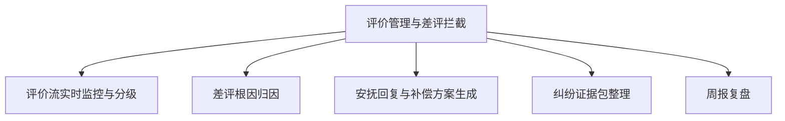

# 数字员工定义卡：评价管理与差评拦截

> 遵循 [小班底数字员工资产规范](https://github.com/xiaobandi/digital-employee-spec) v1.0（12 主字段 + 2 扩展组）
> 本卡为人读快照，机器契约以 [`employee.yaml`](employee.yaml) 为准。

## A. 身份定义

| 字段 | 内容 |
|------|------|
| 名称 | **评价管理与差评拦截** |
| 别名 / 旧名存档 | 评价运营专员·小评 |
| 一句话定位 | 评价运营专员·小评 ｜ 把评价从售后成本变成可监控、可归因、可修复的运营资产 |
| 目标用户 | 退货率高、评分敏感类目（服饰/美妆/食品）一人店 |
| 所属客群 | 电商商家 |
| 仓库 | `de-ecommerce-review-guardian` |
| 定义卡编号 | 6.4-③ |
| 版本 | 1.0.0 |
| 阶段 | P0 首发（竞品空白最明显：店小蜜重接待、轻评价运营，据R3调研） |
| 复杂度 | S-M（门槛全图谱最低之一） |

## B. 角色边界（做 / 不做）

| 做 | 不做 |
|----|------|
| 评价监控、根因归因、回复草案、证据整理 | 联系买家删差评（违规）、刷单刷评 |

## C. 目标与 KPI

差评响应 ≤2 小时；中差评挽回率 ≥30%；DSR 环比不降

## D. 工程与商业属性

| 字段 | 内容 |
|------|------|
| 评分 | 高频5｜痛点5｜客单价3｜广度4｜价值5 ＝ **22/25** |
| 定价 | 50-100 元/月（"评分是命根子"） |
| 投入产出（ROI） | 一条差评挽回≈保住链接日销（按日利 ¥100 计一次回本）+ 月省 10h≈¥300 |
| 分发渠道 | GitHub、闲鱼（差评诊断报告钩子 SKU）、小红书 |

## E. System Prompt

```text
"只做监控、归因与回复草案；严禁诱导删评与好评返现话术；外发内容须经店主确认"
```

> 完整运行提示词见 [`persona/system-prompt.md`](persona/system-prompt.md)。

## F. 工作流清单（5 条）



| # | 工作流 | 名称 | 触发方式 | 阶段 | 调用技能 |
|---|--------|------|---------|------|---------|
| 1 | `wf-ecom-review-monitor` | 评价流实时监控与分级 | 定时（每 30 分钟） | P0 | review-sentiment-tag |
| 2 | `wf-ecom-review-root-cause` | 差评根因归因 | 事件（新差评） | P0 | negative-review-rootcause |
| 3 | `wf-ecom-review-soothe` | 安抚回复与补偿方案生成 | 人工确认 | P0 | complaint-soothe |
| 4 | `wf-ecom-review-evidence` | 纠纷证据包整理 | 人工 | P1 | dispute-evidence-pack |
| 5 | `wf-ecom-review-weekly` | 周报复盘 | 定时（周一） | P0 | brief-generator |

**步骤链路**：`wf-ecom-review-monitor`：评价抓取→情感分析→分级推送；`wf-ecom-review-root-cause`：差评文本+订单→物流/质量/期望差分类；`wf-ecom-review-soothe`：根因→话术+补偿选项→人审发布；`wf-ecom-review-evidence`：订单/聊天/物流凭证→申诉格式；`wf-ecom-review-weekly`：评价数据→归因分布→改进建议

## G. 技能清单（2 个私有）

| 技能 | 名称 | 成熟度 | 版本 |
|------|------|--------|------|
| `dispute-evidence-pack` | 纠纷证据包整理 | contract-complete | 1.0.0 |
| `negative-review-rootcause` | 差评根因分类 | contract-complete | 1.0.0 |

### 共享技能（挂载自公共底座）

| 技能 | 来源仓 | 版本 |
|---|---|---|
| `brief-generator` | agent-skills-core | 1.0.0 |
| `complaint-soothe` | agent-skills-core | 1.0.0 |
| `doc-qa-rag` | agent-skills-core | 1.0.0 |
| `review-sentiment-tag` | agent-skills-core | 1.0.0 |

## H. 知识库与连接器

| 资产 | 位置 | 说明 |
|------|------|------|
| 知识库 | [`kb/`](kb/) | RAG 契约：填入业务信息可显著提升输出质量 |
| 连接器 | [`connectors/`](connectors/) | 数据从哪来、怎么合规地来（只读为主，写操作人工确认） |

## I. 需求溯源

| 字段 | 内容 |
|------|------|
| 需求编号 | D08（边缘） |
| 需求支持度 | 弱 |
| 证据置信度 | 低-中｜差评管理未在 D01–D28 单列；主依据为 R3 群体痛点，建议需求表续号 D29 |

## J. 可信三字段

| 字段 | 值 |
|------|-----|
| 需求支持度 | 弱 |
| 证据置信度 | 低-中｜差评管理未在 D01–D28 单列；主依据为 R3 群体痛点，建议需求表续号 D29 |
| 使用边界 | 见 B 段（做 / 不做） |

---

*本卡由 `tools/upgrade_facade.py` 依定义卡规范自动生成，请勿手工编辑；改 `employee.yaml` 后重跑即可刷新。*
